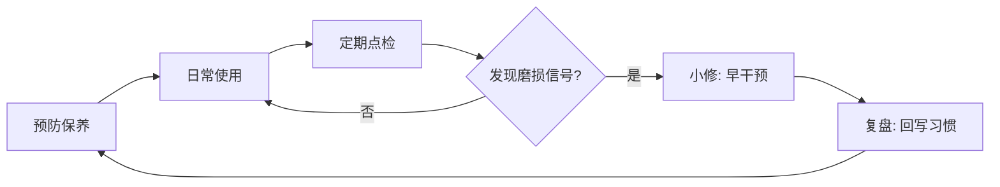

# 个人养护手册 · 总览与导航

> 版本 v1.0 ｜ 生成日期：2026-11-20
> 定位：把身体当作一台需要终身维护的精密机器，为每一个"零件"建立统一格式的养护卡。
> 声明：本手册为健康科普整理，数据取常见通识口径（不同指南间存在差异），不构成诊疗建议；个体情况以最新权威指南与主诊医生意见为准。

---

## 一、手册怎么用

### 1. 核心理念：机器养护四原则

| 原则 | 机器语境 | 身体对应 |
|---|---|---|
| 预防优先 | 预防成本远低于大修 | 疫苗、刷牙、防晒、控盐控糖 |
| 定期点检 | 不等报警才检修 | 年度体检、按年龄专项筛查 |
| 磨损预警 | 异响=低成本维修窗 | 疼痛、出血、结节、指标异常 |
| 规范操作 | 错误用法加速报废 | 低头、久坐、烟酒、熬夜 |

### 2. 统一养护卡：每个零件都按七个维度拆解

1. **功能定位**：这个零件是干什么的
2. **设计寿命**：正常可用年限与退化曲线
3. **日常养护**：每天/每周要做的
4. **定期保养**：每年/每几年要查的
5. **磨损信号**：出现什么说明在老化或故障
6. **常见故障与维修**：高发问题与对应处理层级
7. **禁忌操作**：最伤它的行为

### 3. 养护闭环

### 4. 阅读路径建议

- 必读：**01（牙齿是全身养护的示范样板章）→ 00（本页）→ 15（把养护落进日历）**
- 按需查阅：身体哪个部位有困扰，直接跳对应章节

---

## 二、全身零件清单总表（131 项，逐项映射章节）

> 编号 001–131 连续无跳号，作为"零遗漏"自查底账。同一零件多次出场（如扁桃体 006/117）在主章节深度讲解，其余章节标注"详见"。

| 编号 | 零件/结构（含关键子结构） | 章 |
|---|---|---|
| 001 | 牙齿（牙釉质·牙本质·牙髓·牙骨质） | 01 |
| 002 | 牙龈与牙周膜 | 01 |
| 003 | 牙槽骨 | 01 |
| 004 | 舌头（味蕾·舌肌） | 01 |
| 005 | 唾液腺（腮腺·颌下腺·舌下腺） | 01 |
| 006 | 扁桃体 | 01·13 |
| 007 | 口咽与软腭 | 01 |
| 008 | 眼睑与睫毛 | 02 |
| 009 | 泪器（泪腺·泪道） | 02 |
| 010 | 角膜 | 02 |
| 011 | 晶状体 | 02 |
| 012 | 视网膜与黄斑 | 02 |
| 013 | 视神经 | 02 |
| 014 | 眼外肌 | 02 |
| 015 | 外耳与外耳道 | 02 |
| 016 | 鼓膜 | 02 |
| 017 | 中耳（听小骨·咽鼓管） | 02 |
| 018 | 耳蜗（听觉毛细胞） | 02 |
| 019 | 前庭（平衡器官） | 02 |
| 020 | 鼻腔与鼻黏膜（含嗅区） | 02 |
| 021 | 鼻窦（4对） | 02 |
| 022 | 喉与声带 | 02 |
| 023 | 大脑（皮层·白质） | 03 |
| 024 | 小脑 | 03 |
| 025 | 脑干 | 03 |
| 026 | 脑膜与脑脊液 | 03 |
| 027 | 脊髓 | 03 |
| 028 | 周围神经（脑神经12对·脊神经31对） | 03 |
| 029 | 自主神经（交感·副交感） | 03 |
| 030 | 心脏（心肌） | 04 |
| 031 | 心瓣膜 | 04 |
| 032 | 心脏传导系统（窦房结等） | 04 |
| 033 | 冠状动脉 | 04 |
| 034 | 主动脉与大动脉 | 04 |
| 035 | 中小动脉 | 04 |
| 036 | 静脉与静脉瓣 | 04 |
| 037 | 毛细血管 | 04 |
| 038 | 红细胞 | 04 |
| 039 | 白细胞 | 04 |
| 040 | 血小板 | 04 |
| 041 | 血浆与凝血系统 | 04 |
| 042 | 气管 | 05 |
| 043 | 支气管（含纤毛-黏液清除系统） | 05 |
| 044 | 肺（左2叶·右3叶） | 05 |
| 045 | 肺泡 | 05 |
| 046 | 胸膜 | 05 |
| 047 | 膈肌 | 05 |
| 048 | 肋间肌等呼吸肌 | 05 |
| 049 | 食管 | 06 |
| 050 | 胃（贲门·胃体·幽门） | 06 |
| 051 | 十二指肠 | 06 |
| 052 | 空肠与回肠 | 06 |
| 053 | 盲肠与阑尾 | 06·13 |
| 054 | 结肠（升·横·降·乙状） | 06 |
| 055 | 直肠 | 06 |
| 056 | 肛门与括约肌 | 06 |
| 057 | 肝脏 | 06 |
| 058 | 胆囊与胆道 | 06 |
| 059 | 胰腺（外分泌部） | 06·12 |
| 060 | 肾脏（约200万个肾单位） | 07 |
| 061 | 输尿管 | 07 |
| 062 | 膀胱 | 07 |
| 063 | 尿道 | 07 |
| 064 | 颅骨 | 08 |
| 065 | 颈椎（7节） | 08 |
| 066 | 胸椎（12节） | 08 |
| 067 | 腰椎（5节） | 08 |
| 068 | 骶尾椎 | 08 |
| 069 | 椎间盘 | 08 |
| 070 | 胸骨与肋骨（12对） | 08 |
| 071 | 骨盆与髋骨 | 08 |
| 072 | 锁骨与肩胛骨 | 08 |
| 073 | 肩关节与肩袖 | 08 |
| 074 | 肘关节 | 08 |
| 075 | 腕关节 | 08 |
| 076 | 髋关节 | 08 |
| 077 | 膝关节（半月板·交叉韧带） | 08 |
| 078 | 踝关节 | 08 |
| 079 | 关节软骨与滑膜 | 08 |
| 080 | 骨组织与骨髓腔 | 08 |
| 081 | 骨骼肌（600余块） | 09 |
| 082 | 心肌 | 04·09 |
| 083 | 平滑肌 | 09 |
| 084 | 核心肌群 | 09 |
| 085 | 肌腱 | 09 |
| 086 | 韧带 | 09 |
| 087 | 筋膜 | 09 |
| 088 | 手部骨与关节（腕8·掌5·指14） | 10 |
| 089 | 腕管（正中神经通道） | 10 |
| 090 | 手指屈肌腱与腱鞘 | 10 |
| 091 | 拇指对掌结构 | 10 |
| 092 | 足部骨与关节（26块） | 10 |
| 093 | 足弓 | 10 |
| 094 | 足底筋膜 | 10 |
| 095 | 跟腱 | 09·10 |
| 096 | 脚趾与拇外翻结构 | 10 |
| 097 | 皮肤（表皮·真皮·皮下） | 11 |
| 098 | 汗腺 | 11 |
| 099 | 皮脂腺 | 11 |
| 100 | 毛发（头发约10万根） | 11 |
| 101 | 头皮 | 11 |
| 102 | 指甲 | 11 |
| 103 | 趾甲 | 11 |
| 104 | 体毛 | 11 |
| 105 | 下丘脑 | 12 |
| 106 | 垂体 | 12 |
| 107 | 松果体 | 12 |
| 108 | 甲状腺 | 12 |
| 109 | 甲状旁腺 | 12 |
| 110 | 肾上腺（皮质·髓质） | 12 |
| 111 | 胰岛 | 12 |
| 112 | 性腺（睾丸·卵巢） | 12·14 |
| 113 | 骨髓 | 13 |
| 114 | 胸腺 | 13 |
| 115 | 脾脏 | 13 |
| 116 | 淋巴结与淋巴管 | 13 |
| 117 | 扁桃体（免疫职能） | 13 |
| 118 | 阑尾（免疫职能） | 13 |
| 119 | 黏膜免疫与肠道菌群 | 13 |
| 120 | 睾丸 | 14 |
| 121 | 附睾与输精管 | 14 |
| 122 | 精囊与射精管 | 14 |
| 123 | 前列腺 | 14 |
| 124 | 阴茎与男性尿道 | 14 |
| 125 | 卵巢 | 14 |
| 126 | 输卵管 | 14 |
| 127 | 子宫 | 14 |
| 128 | 宫颈 | 14 |
| 129 | 阴道与外阴 | 14 |
| 130 | 乳腺 | 14 |
| 131 | 盆底肌 | 14 |

### 覆盖口径说明

- 覆盖：**14 个章节、131 项零件/结构**，编号连续无跳号。
- 交叉项：扁桃体（006/117）、阑尾（053/118）、胰腺（059/111）、心肌（030/082）、性腺（112/120·125）、跟腱（095）等按主章节讲透，旁侧章节标"详见"。
- 不纳入养护范围的：胚胎期结构、退化残余（如眼内角半月皱襞并入 008 眼睑讲解）。

---

## 三、全身保养节律总表

| 频率 | 项目 | 主要受益零件 |
|---|---|---|
| 每日 | 巴氏刷牙×2（各≥2分钟）+ 牙线×1 | 牙齿/牙龈 |
| 每日 | 饮水约1500-1700ml（男1700/女1500参考） | 肾/血管/皮肤 |
| 每日 | 睡眠7-9小时 | 大脑/免疫/内分泌 |
| 每日 | 用眼20-20-20法则 | 眼 |
| 每日 | 出门日防晒 | 皮肤 |
| 每日 | 蔬果约500g、盐<5g、添加糖<25g | 消化/心血管/胰岛 |
| 每周 | 有氧150-300分钟 + 力量2次 | 心/骨/肌/脑 |
| 每月 | 乳房自查（女）/睾丸自查（男）/全身痣检查 | 乳腺/睾丸/皮肤 |
| 每6-12个月 | 洗牙+口腔检查 | 牙齿/牙周 |
| 每年 | 基础体检+血压自测 | 全身 |
| 按年龄 | 专项筛查（详见15章） | 对应系统 |

---

## 四、通用基础：所有零件共享的养护前提

| 前提 | 通识口径 | 影响最大的零件 |
|---|---|---|
| 睡眠 | 7-9小时，固定节律 | 大脑/免疫/内分泌/皮肤 |
| 饮食 | 地中海式：全谷、蔬果500g、鱼2次/周；盐<5g、添加糖<25g、纤维25-30g；加工肉少吃 | 心血管/消化/胰岛 |
| 运动 | 每周150-300分钟中等强度有氧 + 2次力量 | 心/骨/肌/脑/胰岛 |
| 烟酒 | 烟草与酒精均为1类致癌物；酒无"安全剂量"，能不喝不喝 | 肺/肝/心血管/口腔 |
| 体重 | BMI 18.5-23.9（中国成人标准）；腰围男<90cm、女<85cm | 全身 |
| 情绪 | 慢性压力是全身零件的隐形锈蚀剂 | 脑/心血管/免疫 |

---

## 五、红色警报速查（出现即就医或呼叫120）

| 信号 | 提示 | 动作 |
|---|---|---|
| 胸痛压榨感>5分钟，放射左臂/下颌，伴冷汗 | 心梗 | 立即120 |
| 口角歪斜+一侧肢体无力+言语不清 | 卒中（FAST） | 立即120 |
| 突发剧烈"一生最痛"头痛 | 颅内出血可能 | 立即就医 |
| 咯血、呕血、黑便 | 上消化道/呼吸道出血 | 尽快就医 |
| 突发听力骤降 | 突发性耳聋（72小时治疗窗） | 按急诊处理 |
| 突发视力下降/视野缺损/眼前闪光+飞蚊剧增 | 视网膜/神经急症 | 当日就医 |
| 单侧下肢肿痛 | 深静脉血栓（禁忌按摩） | 尽快就医 |
| 外伤后畸形、无法负重 | 骨折 | 制动后就医 |
| 意识模糊、抽搐、高热不退伴颈强直 | 神经系统急症 | 120 |

---

## 六、家庭保养耗材总清单

| 类别 | 清单 |
|---|---|
| 口腔 | 软毛小头牙刷（3个月一换）、含氟牙膏、牙线/牙间刷、刮舌器 |
| 监测 | 上臂式电子血压计、体重秤、体温计、腰围尺（可选血糖仪） |
| 防护 | 防晒霜、UV400墨镜、运动护具、耳塞（演唱会/工地）、N95（雾霾/粉尘） |
| 皮肤 | 温和洁面、保湿霜、趾甲钳（与指甲钳分开） |
| 应急 | 创可贴、碘伏、纱布、退热药、口服补液盐 |
| 档案 | 体检报告按年归档、疫苗接种记录、过敏史一页纸 |

---

## 七、使用声明

1. 本手册各章"通识口径"数据在不同指南间存在差异，已尽量注明区间；执行前以最新权威指南为准。
2. 手册回答"日常怎么养"，不替代诊断；红色警报出现时，先就医再对照手册。
3. 建议每2-3年对照最新指南更新一次个人版本。

> AI生成
