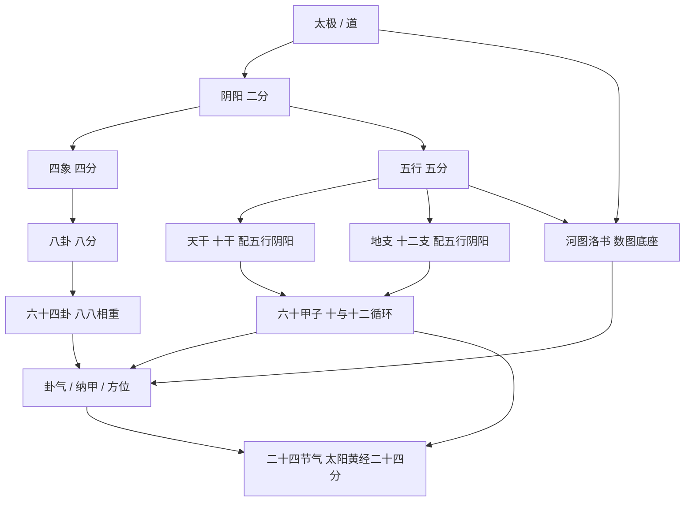

# 国学基础体系总纲

> 本卷为「国学」系列的入口。九部分卷（阴阳、五行、八卦、六十四卦、天干、地支、六十甲子、河图洛书、二十四节气）各自独立成篇，本篇只负责交代**体系结构、公共术语、证据分级与交叉索引**，不重复各卷正文。

---

## 一、一句话总述

中国传统术数与哲学共用一套「**分层取象**」的符号系统：以**阴阳**为二分，以**五行**为五分，以**八卦**为八分，以**天干（十）**、**地支（十二）**为十分与十二分，以**六十甲子**为十分与十二分的最小公倍循环，以**六十四卦**为六爻叠卦的穷举集合，以**河图洛书**为数理底座，以**二十四节气**为太阳黄经的二十四分。它们不是并列的九套知识，而是同一套宇宙论在不同粒度上的展开。

---

## 二、体系层级关系

需要说明：上图是**功能关系图**，不是发生学上的先后顺序。阴阳、五行、八卦在文献中出现的时间并不一致，五行成形于《尚书·洪范》，八卦成卦之说见于《周易·系辞》，二者在战国至汉初才被系统整合。**把图读成「历史演化顺序」是最常见的误读。**

---

## 三、九卷索引

| 编号 | 分卷 | 核心问题 | 关键数 | 主要经典依据 |
|---|---|---|---|---|
| 01 | 阴阳 | 万物为何以两两相对的方式呈现 | 2 | 《周易·系辞》《道德经》《素问·阴阳应象大论》 |
| 02 | 五行 | 五类属性如何相生相克并统摄万物 | 5 | 《尚书·洪范》《素问》《春秋繁露》《白虎通义》 |
| 03 | 八卦 | 三爻如何生成八种基本象 | 8 | 《周易·说卦传》 |
| 04 | 六十四卦 | 六爻叠卦如何穷举并排序 | 64 | 《周易》经文、十翼、《序卦传》 |
| 05 | 天干 | 十干如何纪时并配五行阴阳 | 10 | 《史记·律书》《汉书·律历志》 |
| 06 | 地支 | 十二支如何纪时、藏干并构成刑冲合害 | 12 | 《史记·律书》《汉书·律历志》《淮南子·天文训》 |
| 07 | 六十甲子 | 十干十二支如何相配成六十循环 | 60 | 《汉书·律历志》《素问》运气七篇 |
| 08 | 河图洛书 | 数图如何为五行八卦提供数理底座 | 55 / 45 | 《尚书·顾命》《易·系辞》、宋人易图 |
| 09 | 二十四节气 | 太阳黄经如何划分时序并定月建 | 24 | 《淮南子·天文训》《月令七十二候集解》 |

---

## 四、贯通九卷的公共底层逻辑

### 1. 取象比类，而非实体定义

五行不是五种物质，阴阳不是两种气。它们的本质是**分类标签**：先把对象按性态、方位、时序、功能归入某一类，再据类与类之间的固定关系（生、克、合、冲）推断未知。因此判断一条映射是否成立，不能问「它是不是真的」，只能问「它是否属于某一体系、该体系内部是否自洽」。

### 2. 数序即关系

- 阴阳：奇为阳，偶为阴（一三五七九 / 二四六八十）。
- 五行：河图生成数——天一生水，地六成之；地二生火，天七成之；天三生木，地八成之；地四生金，天九成之；天五生土，地十成之。
- 八卦：乾一、兑二、离三、震四、巽五、坎六、艮七、坤八（先天数）。
- 干支：十与十二的最小公倍数为六十，构成六十甲子。
- 河图洛书：一至十为生成数（和 55），一至九为九宫幻方（和 45，行列对角皆 15）。
- 节气：太阳黄经每 15° 为一节气，360° 得二十四分。

### 3. 同构对应

同一对象可以同时挂在阴阳、五行、八卦、干支四条线索上。例如「东」：阴阳属阳，五行属木，八卦属震巽，天干属甲乙，地支属寅卯。**四条线索不是四个结论，而是同一结论的四种编码。**交叉验证时，若某一对象在四条线索上指向互相矛盾的行属，通常说明取象标准不一致，需回查依据。

---

## 五、证据分级（全系列统一体例）

本系列所有条目均标注证据等级，避免把后世术数用法误当成经典原文。

| 等级 | 标记 | 含义 | 示例 |
|---|---|---|---|
| A | 【经文】 | 先秦两汉经典原文可直接对应 | 《洪范》「水曰润下，火曰炎上」 |
| B | 【注疏】 | 汉唐注疏、史志律历明确记载 | 《汉书·律历志》十干训诂 |
| C | 【术数】 | 命理、风水、择日等术数体系的通行用法，经典未直接规定 | 天干合化、地支藏干 |
| D | 【民俗】 | 民间信仰、年画、端午习俗等 | 五毒（蛇蝎蜈蚣壁虎蟾蜍）配五行 |
| E | 【推演】 | 本系列为实现体系闭合而作的推导，原著未及 | 五毒（贪嗔痴慢疑）按五方佛方位配五行 |

**规则：E 级结论不得单独作为论据引用；D 级结论须注明地域或载体；C 级结论须注明所属术数门类。**

---

## 六、可证伪的校验清单

任何一条「甲配乙」的映射，都可用以下五问自检：

1. **出处问**：这条映射最早见于哪部书？若答不出，至少标注 D 或 E。
2. **体系问**：它属于中医、命理、风水、音律、佛教中的哪一套？不同体系不得混用。
3. **方向问**：生克是有向的（木克土 ≠ 土克木），合化是有条件的，方位是有参照系的（先天/后天）。
4. **冲突问**：同一对象是否在另一体系中得到不同归属？若有，须并列而非择一掩盖。
5. **反例问**：能否举出一个按该映射应成立、实际却不成立的反例？举得出，说明该映射只在特定语境有效。

---

## 七、建议阅读路径

- **入门**：01 阴阳 → 02 五行 → 03 八卦
- **术数向**：02 五行 → 05 天干 → 06 地支 → 07 六十甲子 → 04 六十四卦
- **义理向**：01 阴阳 → 03 八卦 → 04 六十四卦
- **数理向**：08 河图洛书 → 02 五行 → 03 八卦
- **历法向**：09 二十四节气 → 05 天干 → 06 地支 → 07 六十甲子
- **查表向**：直接进入任一分卷的「总表」章节

---

## 八、术语速查

| 术语 | 含义 |
|---|---|
| 爻 | 卦的基本单位，阳爻「—」、阴爻「--」 |
| 象 | 卦所象征的事物类别 |
| 位 | 爻在卦中的次序，初、二、三、四、五、上 |
| 当位 | 阳爻居阳位（初三五）、阴爻居阴位（二四六） |
| 中 | 二爻为下卦之中，五爻为上卦之中 |
| 应 | 初与四、二与五、三与上，阴阳相应 |
| 比 | 相邻两爻的关系 |
| 错卦 | 六爻全部阴阳互换 |
| 综卦 | 整卦上下颠倒 |
| 互卦 | 取二三四爻为下卦、三四五爻为上卦 |
| 纳甲 | 将干支配入卦爻的术数方法 |
| 藏干 | 地支中所含天干 |
| 月建 | 以节气定月份所对应的地支 |
| 纳音 | 六十甲子每两组共用的五行名 |
| 旬空 | 每旬十日配十二支所余的二支 |
| 节 / 中气 | 每月前一个节气为节，后一个为中气 |
| 生成数 | 河图一至五为生数，六至十为成数 |
| 消息卦 | 以十二卦对应十二月建，表示阴阳消长 |

---

## 九、参考文献

[1] 王弼, 注. 周易正义[M]. 孔颖达, 疏. 北京: 北京大学出版社, 2000.（十三经注疏整理本；卷页待核）

[2] 孔安国, 传. 尚书正义[M]. 孔颖达, 疏. 北京: 北京大学出版社, 2000.（十三经注疏整理本；卷页待核）

[3] 佚名. 黄帝内经·素问[M]. 北京: 人民卫生出版社, 2012.（通行校点本；篇目可核，页码待核）

[4] 司马迁. 史记[M]. 北京: 中华书局, 1959.（《律书》《历书》；页码待核）

[5] 班固. 汉书[M]. 北京: 中华书局, 1962.（《律历志》；页码待核）

[6] 董仲舒. 春秋繁露[M]. 北京: 中华书局, 1975.（页码待核）

[7] 班固. 白虎通义[M]. 北京: 中华书局, 1994.（页码待核）

[8] 周敦颐. 太极图说[M]//周敦颐集. 北京: 中华书局, 1990.（页码待核）

[9] 刘安, 编. 淮南子[M]. 北京: 中华书局, 2010.（《天文训》；页码待核）

[10] 吴澄. 月令七十二候集解[M]. 北京: 中华书局, 2013.（页码待核）

[11] 胡渭. 易图明辨[M]. 北京: 中华书局, 2008.（河图洛书源流考辨；卷页待核）

> 说明：以上版本信息按通行整理本著录；凡未能亲见原书核对者，页码一律标「待核」，不作精确引用。网络来源（如维基百科「五行」条目）仅作检索线索，正式引用以纸质整理本为准。
