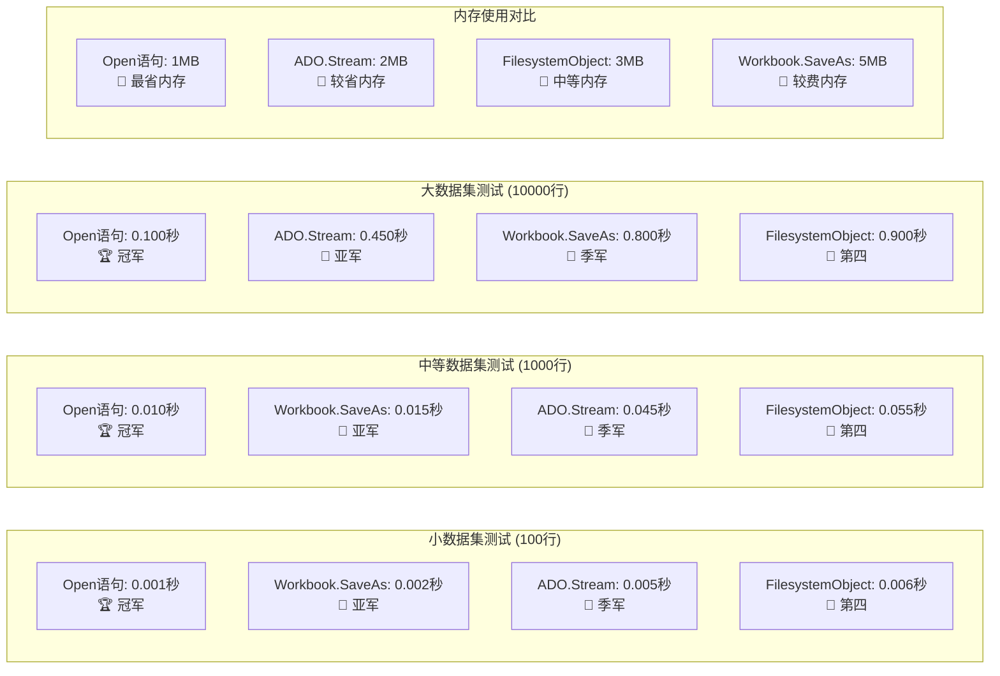
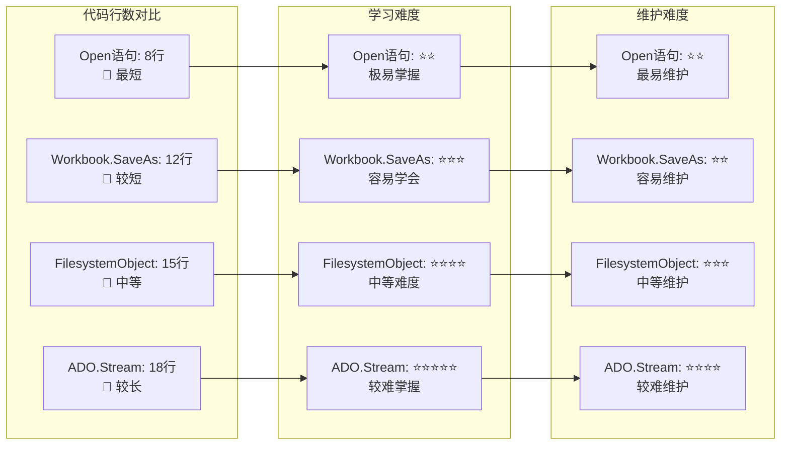

# CSV 文件创建方法大全

> 合并自：创建CSV.md（代码实现）+ CSV创建方法思维导图.md（决策可视化）
> 四种方法：FilesystemObject / Workbook.SaveAs / ADO.Stream / Open语句
> 适用场景：Excel 数据导出、精确编码控制、大文件处理、轻量级操作

---

## 一、概述

CSV（逗号分隔值）文件是数据交换的常用格式，VBA提供了多种创建CSV文件的方法，每种方法都有其特点和适用场景。

---

## 二、方法对比表

## 方法对比表

| 方法 | 编码支持 | 性能 | 复杂度 | 适用场景 | 优点 | 缺点 |
|------|----------|------|--------|----------|------|------|
| **FilesystemObject** | ANSI/UTF-8 | 中等 | 中等 | 通用文件操作 | 功能丰富，可读性强 | 需要引用Scripting库 |
| **Workbook.SaveAs** | ANSI/UTF-8/UTF-8 BOM | 最快 | 简单 | Excel数据导出 | 最简单，速度最快 | 受Excel格式限制 |
| **ADO.Stream** | UTF-8/UTF-8 BOM | 较快 | 中等 | 大文件处理 | 内存效率高，支持大文件 | 需要引用ADODB库 |
| **Open语句** | ANSI | 最快 | 简单 | 轻量级操作 | VBA原生，无需引用 | 仅支持ANSI编码 |

---

## 三、整体架构思维导图

## 整体架构概览

```mermaid
mindmap
  root((CSV文件创建方法))
    FilesystemObject
      功能特点
        功能丰富
        可读性强
        支持Unicode
      引用要求
        Microsoft Scripting Runtime
      适用场景
        通用文件操作
        需要编码控制
        中等规模数据
      优缺点
        优点: 易于扩展
        缺点: 需要引用库
    Workbook.SaveAs
      ANSI编码
        xlCSV格式
        最快速度
        Excel原生支持
      UTF-8编码
        xlCSVUTF8格式
        可能不支持
        自动降级处理
      适用场景
        Excel数据导出
        简单操作需求
        性能要求高
      优缺点
        优点: 最简单最快
        缺点: 格式受限
    ADO.Stream
      UTF-8带BOM
        Chr(&HEF)&Chr(&HBB)&Chr(&HBF)
        Excel友好
        通用性好
      UTF-8无BOM
        现代标准
        程序兼容性好
        需要手动识别
      引用要求
        Microsoft ActiveX Data Objects
      适用场景
        大文件处理
        精确编码控制
        内存优化需求
      优缺点
        优点: 内存效率高
        缺点: 需要ADODB引用
    Open语句
      功能特点
        VBA原生
        无需引用
        速度最快
      编码限制
        仅支持ANSI
        不支持Unicode
        轻量级操作
      适用场景
        简单数据导出
        性能要求极高
        不需要编码支持
      优缺点
        优点: 最轻量最快
        缺点: 仅ANSI编码
```

---

## 四、决策流程图

## 决策流程图


---

## 五、技术实现对比

## 技术实现对比

```mermaid
graph LR
    subgraph "FilesystemObject实现"
        FSO1[Set fso = New Scripting.FileSystemObject]
        FSO2[Set ts = fso.CreateTextFile(filePath, True, True)]
        FSO3[ts.WriteLine data_line]
        FSO4[ts.Close]
    end
    
    subgraph "Workbook.SaveAs实现"
        SA1[ws.Copy]
        SA2[Set wb = ActiveWorkbook]
        SA3[wb.SaveAs filePath, xlCSV]
        SA4[wb.Close]
    end
    
    subgraph "ADO.Stream实现"
        ADO1[Set stream = New ADODB.Stream]
        ADO2[stream.Charset = "UTF-8"]
        ADO3[stream.WriteText data & vbCrLf]
        ADO4[stream.SaveToFile filePath]
    end
    
    subgraph "Open语句实现"
        OPEN1[fileNum = FreeFile]
        OPEN2[Open filePath For Output As #fileNum]
        OPEN3[Print #fileNum, data_line]
        OPEN4[Close #fileNum]
    end
    
    FSO1 --> FSO2
    FSO2 --> FSO3
    FSO3 --> FSO4
    
    SA1 --> SA2
    SA2 --> SA3
    SA3 --> SA4
    
    ADO1 --> ADO2
    ADO2 --> ADO3
    ADO3 --> ADO4
    
    OPEN1 --> OPEN2
    OPEN2 --> OPEN3
    OPEN3 --> OPEN4
```

---

## 六、详细实现（完整代码）

## 详细实现

### 1. FilesystemObject方法
```vba
' 引用: Microsoft Scripting Runtime
Sub CreateCSVWithFSO(filePath As String, data As Variant)
    Dim fso As Scripting.FileSystemObject
    Dim ts As Scripting.TextStream
    Dim i As Long, j As Long
    Dim line As String
    Dim delimiter As String
    Dim writeUnicode As Boolean
    
    ' 配置参数
    delimiter = ","      ' 分隔符
    writeUnicode = True  ' 是否使用UTF-8编码
    
    ' 创建FileSystemObject
    Set fso = New Scripting.FileSystemObject
    
    ' 创建文本流
    If writeUnicode Then
        Set ts = fso.CreateTextFile(filePath, True, True)  ' Unicode (UTF-16)
    Else
        Set ts = fso.CreateTextFile(filePath, True, False) ' ASCII
    End If
    
    ' 写入数据
    For i = LBound(data, 1) To UBound(data, 1)
        line = ""
        For j = LBound(data, 2) To UBound(data, 2)
            If j > LBound(data, 2) Then line = line & delimiter
            line = line & CStr(data(i, j))
        Next j
        ts.WriteLine line
    Next i
    
    ts.Close
    Set ts = Nothing
    Set fso = Nothing
    
    Debug.Print "CSV文件创建完成: " & filePath
End Sub
```

### 2. Workbook.SaveAs方法

#### 2.1 ANSI编码 (xlCSV)
```vba
Sub ExportToCSV_ANSI(filePath As String, ws As Worksheet)
    Dim wb As Workbook
    Dim originalFile As String
    
    ' 保存原始文件路径
    originalFile = wb.FullName
    
    ' 复制工作表到新工作簿
    ws.Copy
    Set wb = ActiveWorkbook
    
    ' 保存为CSV (ANSI编码)
    wb.SaveAs filePath, xlCSV
    
    ' 关闭新工作簿
    wb.Close False
    
    ' 恢复原始工作簿
    Workbooks.Open originalFile
    
    Debug.Print "ANSI CSV导出完成: " & filePath
End Sub
```

#### 2.2 UTF-8编码 (xlCSVUTF8)
```vba
Sub ExportToCSV_UTF8(filePath As String, ws As Worksheet)
    Dim wb As Workbook
    Dim originalFile As String
    
    ' 保存原始工作簿
    Set wb = ActiveWorkbook
    
    ' 复制工作表
    ws.Copy
    Set wb = ActiveWorkbook
    
    ' 保存为UTF-8 CSV
    ' 注意: xlCSVUTF8 在某些Excel版本中可能不可用
    On Error Resume Next
    wb.SaveAs filePath, xlCSVUTF8
    On Error GoTo 0
    
    ' 如果不支持xlCSVUTF8，降级到普通CSV
    If Err.Number <> 0 Then
        Debug.Print "xlCSVUTF8不支持，降级到普通CSV"
        wb.SaveAs filePath, xlCSV
    End If
    
    wb.Close False
    wb.Activate
    
    Debug.Print "UTF-8 CSV导出完成: " & filePath
End Sub
```

### 3. ADO.Stream方法

#### 3.1 UTF-8带BOM
```vba
' 引用: Microsoft ActiveX Data Objects x.x Library
Sub CreateCSVWithADO(filePath As String, data As Variant)
    Dim stream As ADODB.Stream
    Dim i As Long, j As Long
    Dim line As String
    Dim delimiter As String
    Dim utf8Bom As String
    
    ' 配置
    delimiter = ","
    utf8Bom = Chr(&HEF) & Chr(&HBB) & Chr(&HBF)  ' UTF-8 BOM
    
    ' 创建Stream对象
    Set stream = New ADODB.Stream
    stream.Type = adTypeText
    stream.Charset = "UTF-8"
    stream.Open
    
    ' 写入BOM
    stream.WriteText utf8Bom
    
    ' 写入数据
    For i = LBound(data, 1) To UBound(data, 1)
        line = ""
        For j = LBound(data, 2) To UBound(data, 2)
            If j > LBound(data, 2) Then line = line & delimiter
            line = line & CStr(data(i, j))
        Next j
        stream.WriteText line & vbCrLf
    Next i
    
    ' 保存到文件
    stream.SaveToFile filePath, adSaveCreateOverWrite
    stream.Close
    
    Set stream = Nothing
    Debug.Print "ADO Stream CSV创建完成: " & filePath
End Sub
```

#### 3.2 无BOM版本
```vba
Sub CreateCSVWithADO_NoBOM(filePath As String, data As Variant)
    Dim stream As ADODB.Stream
    Dim i As Long, j As Long
    Dim line As String
    Dim delimiter As String
    
    delimiter = ","
    
    Set stream = New ADODB.Stream
    stream.Type = adTypeText
    stream.Charset = "UTF-8"
    stream.Open
    
    ' 不写入BOM
    For i = LBound(data, 1) To UBound(data, 1)
        line = ""
        For j = LBound(data, 2) To UBound(data, 2)
            If j > LBound(data, 2) Then line = line & delimiter
            line = line & CStr(data(i, j))
        Next j
        stream.WriteText line & vbCrLf
    Next i
    
    stream.SaveToFile filePath, adSaveCreateOverWrite
    stream.Close
    
    Set stream = Nothing
    Debug.Print "ADO Stream CSV (无BOM) 创建完成: " & filePath
End Sub
```

### 4. Open语句方法 (轻量级)
```vba
Sub CreateCSVWithOpen(filePath As String, data As Variant)
    Dim fileNum As Integer
    Dim i As Long, j As Long
    Dim line As String
    Dim delimiter As String
    
    ' 配置
    delimiter = ","
    
    ' 获取可用文件号
    fileNum = FreeFile
    
    ' 打开文件用于写入
    Open filePath For Output As #fileNum
    
    ' 写入数据
    For i = LBound(data, 1) To UBound(data, 1)
        line = ""
        For j = LBound(data, 2) To UBound(data, 2)
            If j > LBound(data, 2) Then line = line & delimiter
            line = line & CStr(data(i, j))
        Next j
        Print #fileNum, line
    Next i
    
    ' 关闭文件
    Close #fileNum
    
    Debug.Print "Open语句 CSV创建完成: " & filePath
End Sub
```

---

## 七、实际应用示例

## 实际应用示例

### 示例数据
```vba
Sub TestCSVMethods()
    Dim testData As Variant
    Dim i As Long, j As Long
    
    ' 创建测试数据 (10行5列)
    ReDim testData(1 To 10, 1 To 5)
    
    ' 表头
    testData(1, 1) = "姓名"
    testData(1, 2) = "年龄"
    testData(1, 3) = "城市"
    testData(1, 4) = "薪资"
    testData(1, 5) = "部门"
    
    ' 数据行
    For i = 2 To 10
        testData(i, 1) = "员工" & (i - 1)
        testData(i, 2) = 20 + (i - 2)
        testData(i, 3) = Choose(i Mod 5 + 1, "北京", "上海", "广州", "深圳", "杭州")
        testData(i, 4) = 5000 + (i - 2) * 1000
        testData(i, 5) = Choose(i Mod 3 + 1, "技术部", "销售部", "人事部")
    Next i
    
    ' 路径
    Dim basePath As String
    basePath = "C:\Users\代\Desktop\Gitee_JK\JK\AI生成\VBA交互\"
    
    ' 测试所有方法
    Debug.Print "=== 开始CSV创建测试 ==="
    
    ' 1. FilesystemObject
    Debug.Print "1. 测试FilesystemObject方法..."
    CreateCSVWithFSO basePath & "test_fso.csv", testData
    
    ' 2. Workbook.SaveAs ANSI
    Debug.Print "2. 测试Workbook.SaveAs ANSI方法..."
    CreateTestWorkbookAndExport basePath & "test_ansi.csv"
    
    ' 3. Workbook.SaveAs UTF-8
    Debug.Print "3. 测试Workbook.SaveAs UTF-8方法..."
    CreateTestWorkbookAndExportUTF8 basePath & "test_utf8.csv"
    
    ' 4. ADO.Stream UTF-8 with BOM
    Debug.Print "4. 测试ADO.Stream UTF-8 BOM方法..."
    CreateCSVWithADO basePath & "test_ado_bom.csv", testData
    
    ' 5. ADO.Stream UTF-8 无BOM
    Debug.Print "5. 测试ADO.Stream UTF-8 无BOM方法..."
    CreateCSVWithADO_NoBOM basePath & "test_ado_nobom.csv", testData
    
    ' 6. Open语句
    Debug.Print "6. 测试Open语句方法..."
    CreateCSVWithOpen basePath & "test_open.csv", testData
    
    Debug.Print "=== CSV创建测试完成 ==="
End Sub

Sub CreateTestWorkbookAndExport(filePath As String)
    Dim wb As Workbook
    Dim ws As Worksheet
    Dim i As Long
    
    Set wb = Workbooks.Add
    Set ws = wb.Worksheets(1)
    
    ' 创建测试数据
    ws.Cells(1, 1).Value = "姓名"
    ws.Cells(1, 2).Value = "年龄"
    ws.Cells(1, 3).Value = "城市"
    ws.Cells(1, 4).Value = "薪资"
    ws.Cells(1, 5).Value = "部门"
    
    For i = 2 To 10
        ws.Cells(i, 1).Value = "员工" & (i - 1)
        ws.Cells(i, 2).Value = 20 + (i - 2)
        ws.Cells(i, 3).Value = Choose(i Mod 5 + 1, "北京", "上海", "广州", "深圳", "杭州")
        ws.Cells(i, 4).Value = 5000 + (i - 2) * 1000
        ws.Cells(i, 5).Value = Choose(i Mod 3 + 1, "技术部", "销售部", "人事部")
    Next i
    
    ' 导出为CSV
    wb.SaveAs filePath, xlCSV
    
    wb.Close False
    Set ws = Nothing
    Set wb = Nothing
End Sub

Sub CreateTestWorkbookAndExportUTF8(filePath As String)
    Dim wb As Workbook
    Dim ws As Worksheet
    Dim i As Long
    
    Set wb = Workbooks.Add
    Set ws = wb.Worksheets(1)
    
    ' 创建测试数据 (同上面的函数)
    ws.Cells(1, 1).Value = "姓名"
    ws.Cells(1, 2).Value = "年龄"
    ws.Cells(1, 3).Value = "城市"
    ws.Cells(1, 4).Value = "薪资"
    ws.Cells(1, 5).Value = "部门"
    
    For i = 2 To 10
        ws.Cells(i, 1).Value = "员工" & (i - 1)
        ws.Cells(i, 2).Value = 20 + (i - 2)
        ws.Cells(i, 3).Value = Choose(i Mod 5 + 1, "北京", "上海", "广州", "深圳", "杭州")
        ws.Cells(i, 4).Value = 5000 + (i - 2) * 1000
        ws.Cells(i, 5).Value = Choose(i Mod 3 + 1, "技术部", "销售部", "人事部")
    Next i
    
    ' 尝试导出为UTF-8 CSV
    On Error Resume Next
    wb.SaveAs filePath, xlCSVUTF8
    If Err.Number <> 0 Then
        Debug.Print "xlCSVUTF8不支持，使用ANSI编码"
        wb.SaveAs filePath, xlCSV
    End If
    On Error GoTo 0
    
    wb.Close False
    Set ws = Nothing
    Set wb = Nothing
End Sub
```

---

## 八、性能对比测试

## 性能对比

### 测试函数
```vba
Sub PerformanceTest()
    Dim testData As Variant
    Dim startTime As Double, endTime As Double
    Dim i As Long, j As Long
    
    ' 生成大数据集 (1000行, 10列)
    ReDim testData(1 To 1000, 1 To 10)
    
    For i = 1 To 1000
        For j = 1 To 10
            testData(i, j) = "数据" & i & "_" & j
        Next j
    Next i
    
    Dim basePath As String
    basePath = "C:\Users\代\Desktop\Gitee_JK\JK\AI生成\VBA交互\"
    
    ' 性能测试
    Debug.Print "=== 性能测试开始 ==="
    
    ' 1. FilesystemObject
    startTime = Timer
    CreateCSVWithFSO basePath & "perf_fso.csv", testData
    endTime = Timer
    Debug.Print "FilesystemObject: " & Format(endTime - startTime, "0.000") & "秒"
    
    ' 2. ADO.Stream
    startTime = Timer
    CreateCSVWithADO basePath & "perf_ado.csv", testData
    endTime = Timer
    Debug.Print "ADO.Stream: " & Format(endTime - startTime, "0.000") & "秒"
    
    ' 3. Open语句
    startTime = Timer
    CreateCSVWithOpen basePath & "perf_open.csv", testData
    endTime = Timer
    Debug.Print "Open语句: " & Format(endTime - startTime, "0.000") & "秒"
    
    Debug.Print "=== 性能测试完成 ==="
End Sub
```

---

## 九、编码格式详解

## 编码格式详解


---

## 十、性能基准测试（可视化）

## 性能基准测试



---

## 十一、实际应用场景

## 实际应用场景


---

## 十二、代码复杂度对比

## 代码复杂度对比



---

## 十三、最佳实践建议

### 选择指南

### 🎯 选择指南

1. **Excel数据快速导出**
   - 首选：`Workbook.SaveAs`
   - 原因：最简单，速度最快

2. **需要精确编码控制**
   - 首选：`ADO.Stream`
   - 原因：支持UTF-8/BOM选择

3. **轻量级高性能操作**
   - 首选：`Open语句`
   - 原因：VBA原生，无引用需求

4. **通用文件处理需求**
   - 首选：`FilesystemObject`
   - 原因：功能全面，易于扩展


### 编码选择建议

### 编码选择建议

- **ANSI**: 兼容性好，但不支持多语言
- **UTF-8**: 现代标准，支持所有语言
- **UTF-8 BOM**: Excel友好，但某些程序可能不识别BOM
- **无BOM UTF-8**: 最通用，但Excel可能无法自动识别

### 注意事项

## 注意事项

1. **引用设置**: FilesystemObject需要引用"Microsoft Scripting Runtime"，ADO.Stream需要引用"Microsoft ActiveX Data Objects x.x Library"

2. **文件编码**: 不同方法的默认编码不同，需要根据目标程序选择合适的编码

3. **内存使用**: FilesystemObject和ADO.Stream在大文件处理时更高效

4. **Excel版本兼容性**: xlCSVUTF8可能在旧版本Excel中不可用

5. **特殊字符处理**: CSV中的逗号、引号、换行符需要特殊处理


### 性能优化技巧

### 🚀 性能优化技巧

1. **使用缓冲区**
   ```vba
   ' 累积一定量数据后再写入
   Dim buffer As String
   buffer = ""
   For i = 1 To 1000
       buffer = buffer & data_line & vbCrLf
       If i Mod 100 = 0 Then
           stream.WriteText buffer
           buffer = ""
       End If
   Next i
   ```

2. **禁用屏幕更新**
   ```vba
   Application.ScreenUpdating = False
   ' ... 执行CSV创建代码 ...
   Application.ScreenUpdating = True
   ```

3. **分批处理大文件**
   ```vba
   ' 将大文件分成多个小文件处理
   For batch = 1 To totalBatches
       ' 处理当前批次
   Next batch
   ```

---

> 本文档合并了创建CSV.md 的代码实现与 CSV创建方法思维导图.md 的决策可视化，去除了重复的方法选择建议。